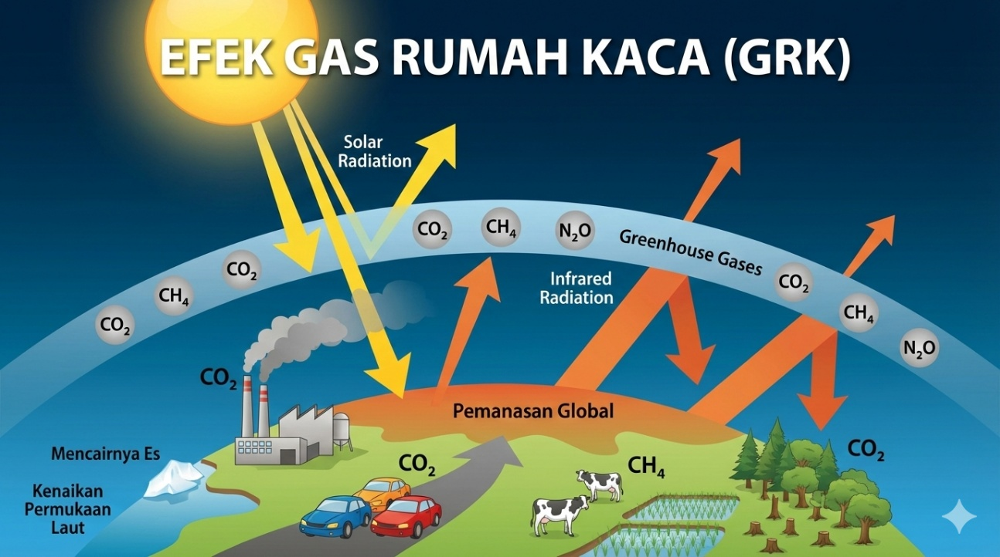

<h1 align="center"><b>IKLIMARA</b></h1>

<p align="center"><b><i>Pahami • Peduli • Bergerak</i></b></p>

Iklimara adalah website edukasi yang mengajak masyarakat mengenal perubahan iklim, untuk memahami penyebab, dampak, serta mempelajari langkah mitigasi dan adaptasi yang dapat dilakukan untuk menghadapi tantangan lingkungan. Website ini dikembangkan sebagai media pembelajaran yang mengacu pada Sustainable Development Goal (SDG) 13, yaitu Aksi Iklim: Perubahan Iklim dan Lingkungan. Website ini dikembangkan sebagai proyek UTS mata kuliah Pemrograman Web menggunakan HTML5 dan CSS3.

---
---
## Anggota Kelompok
---
| No | Nama | NIM | Tugas |
|---|---|---|---|
| 1 | Kadek Julita Widianti | 2515091010 |  |
| 2 | Marsel Gultom | 2515091069 |  | 
| 3 | Kadek Tito Marditya Putra | 2515091104 |  |
| 4 | Ronatio Br Parhusip | 2515091147 |  |
| 5 | Putu Nanda Devani Aprilia | 2515091022 |  |

---
---
## Deskripsi Website
---
### Latar Belakang
Perubahan iklim merupakan persoalan lingkungan yang berkaitan dengan peningkatan suhu global, perubahan pola cuaca, risiko bencana, kondisi ekosistem, dan kehidupan manusia. Pemahaman mengenai persoalan ini perlu dibangun melalui informasi yang mudah dipahami, tetapi tetap mengacu pada sumber yang dapat dipertanggungjawabkan.
Iklimara dikembangkan sebagai media pembelajaran yang menyajikan materi perubahan iklim dalam beberapa halaman yang saling terhubung. Materi dimulai dari pengenalan konsep dasar, dilanjutkan dengan penyebab dan dampak, kemudian membahas mitigasi serta adaptasi. Susunan ini membantu pengguna memahami persoalan sebelum mempelajari tindakan yang dapat dilakukan.

---
### Filosofi Nama Iklimara
Nama Iklimara merupakan nama kreatif yang berangkat dari kata iklim dan merepresentasikan hubungan antara perubahan iklim, kehidupan manusia, serta masa depan bumi. Nama ini tidak memiliki kepanjangan baku, tetapi memiliki filosofi yang selaras dengan tujuan website, yaitu mengajak manusia memahami perubahan iklim dan berperan dalam menghadapinya.

Iklimara mengusung tiga nilai utama:
- Pahami — mengenali penyebab dan dampak perubahan iklim berdasarkan informasi yang tepercaya.
- Peduli — menumbuhkan kesadaran terhadap dampak perubahan iklim bagi manusia dan lingkungan.
- Bergerak — menerapkan tindakan nyata melalui mitigasi dan adaptasi perubahan iklim.

---
### Tujuan Website
Iklimara dikembangkan untuk:
1. Menyediakan informasi pengantar mengenai perubahan iklim dengan bahasa yang mudah dipahami.
2. Menjelaskan hubungan antara aktivitas manusia, emisi gas rumah kaca, dan perubahan iklim.
3. Mengenalkan dampak perubahan iklim terhadap lingkungan dan kehidupan masyarakat.
4. Memperkenalkan tindakan mitigasi untuk mengurangi penyebab perubahan iklim.
5. Menjelaskan adaptasi untuk menghadapi risiko perubahan iklim.
6. Mengembangkan website edukasi multipage yang menerapkan HTML5, CSS3, navigasi ant halaman, dan desain responsif.

---
### Manfaat
1. Bagi pelajar dan mahasiswa: menjadi bahan pengantar untuk mempelajari perubahan iklim dan SDG 13.
2. Bagi masyarakat umum: membantu mengenali penyebab, risiko, dan langkah penanganan perubahan iklim.
3. Bagi pengembang: menjadi penerapan praktis dalam membangun website statis dengan struktur HTML yang terorganisasi dan CSS responsif.

---
### Sasaran Pengguna
Sasaran utama Iklimara adalah pelajar, mahasiswa, komunitas dan masyarakat umum yang ingin memahami perubahan iklim tanpa harus memulai dari pembahasan ilmiah yang terlalu teknis.

---
### Hubungan dengan SDG 13
SDG 13 berfokus pada tindakan segera untuk mengatasi perubahan iklim dan dampaknya. Iklimara mendukung pengenalan tujuan tersebut melalui materi edukatif tentang konsep perubahan iklim, sumber emisi, dampak, mitigasi, dan adaptasi. Website ini berfungsi sebagai media pengenalan, bukan pengganti data ilmiah terbaru atau panduan resmi dari lembaga terkait.

---
---
## Struktur Halaman Website
---
Iklimara terdiri atas tujuh halaman HTML yang saling terhubung melalui navigasi utama.
| No | Halaman | File | Isi Utama |
|---|---|---|---|
| 1 | Beranda | index.html | Memperkenalkan Iklimara, menjelaskan relevansi SDG 13, ringkasan materi dan mengarahkan pengguna ke materi utama. |
| 2 | Iklim | iklim.html | Membahas pengertian perubahan iklim, perbedaan cuaca dan iklim, efek rumah kaca, dan tanda perubahan iklim |
| 3 | Penyebab | penyebab.html | Menjelaskan peran aktivitas manusia, pembakaran bahan bakar fosil, perubahan penggunaan lahan, serta sumber emisi gas rumah kaca. |
| 4 | Dampak | dampak.html | Menguraikan resiko perubahan iklim terhadap manusia, wilayah pesisir, pertanian, kesehatan, dan ekosistem. | 
| 5 | Mitigasi | mitigasi.html | Membahas upaya mengurangi emisi gas rumah kaca dan meningkatkan penyerapan karbon, termasuk peran individu dan perubahan sistem. |
| 6 | Adaptasi | adaptasi.html | Mengenalkan penyesuaian terhadap risiko perubahan iklim pada sektor pertanian, kehutanan, air, masyarakat, tata ruang, dan perikanan budidaya |
| 7 | Tentang | tentang.html | Tujuan website, keterkaitan dengan SDG 13, referensi, dan informasi anggota kelompok |

---
---
## Teknologi Yang Digunakan
---
1. HTML5:
HTML5 digunakan untuk membangun struktur dan isi setiap halaman. Elemen HTML mengatur navigasi, teks, gambar, kartu informasi, kuis, daftar periksa, dan elemen informasi tambahan serta tautan ant halaman.
2. CSS3:
CSS3 digunakan untuk mengatur tampilan visual, termasuk warna, tipografi, jarak, ukuran, tata letak, gambar, dan tampilan komponen. Pemisahan CSS ke dalam file eksternal membuat aturan tampilan dapat dikelola tanpa mencampurkannya dengan isi HTML.
3. CSS Flexbox:
Flexbox digunakan untuk menyusun elemen dalam satu arah, seperti logo dan navigasi pada bagian header. Pengaturan ini membantu elemen tersusun secara horizontal dan menyesuaikan ruang yang tersedia.
4. CSS Grid:
CSS Grid digunakan untuk menyusun elemen dalam baris dan kolom, misalnya pada bagian hero atau kumpulan kartu konten, sesuai aturan yang diterapkan pada stylesheet halaman.
5. CSS Media Queries:
Media queries digunakan untuk menyesuaikan tampilan pada ukuran layar yang berbeda. Penyesuaian dapat mencakup jarak, ukuran elemen, dan tata letak agar halaman lebih nyaman dibaca pada desktop maupun perangkat dengan layar lebih kecil.
6. Google Fonts:
Digunakan untuk menerapkan jenis huruf seperti DM Sans dan Manrope agar tampilan teks pada website lebih konsisten dan mudah dibaca.
7. Aset Gambar: 
Gambar dan logo disimpan dalam folder images/. Semua file dalam folder images/ adalah aset. Aset digunakan untuk mendukung konteks materi, memperjelas penyajian, dan menjaga identitas visual website.

---
---
## Penjelasan Implementasi
---
### Struktur Dasar HTML5
File contoh: index.html
```
<!DOCTYPE html>
<html lang="id">
<head>
  <meta charset="UTF-8">
  <meta name="viewport"
        content="width=device-width, initial-scale=1.0">
  <meta name="description"
        content="Iklimara, ruang belajar perubahan iklim dan aksi iklim.">
  <title>Beranda — Iklimara</title>
  <link rel="stylesheet" href="css/index.css">
</head>
<body>
  <header class="topbar">
    <!-- Identitas website dan navigasi -->
  </header>

  <main>
    <!-- Konten utama halaman -->
  </main>
</body>
</html>
```
Penjelasan:
- <!DOCTYPE html> menyatakan bahwa dokumen menggunakan HTML modern.
- <html lang="id"> menetapkan bahasa utama halaman sebagai bahasa Indonesia.
- <meta charset="UTF-8"> mendukung penampilan karakter dan simbol.
- meta viewport membantu browser menyesuaikan lebar tampilan dengan perangkat yang digunakan.
- meta description memberikan ringkasan isi halaman.
- <title> menentukan judul halaman pada tab browser.
- <link rel="stylesheet"> menghubungkan dokumen HTML dengan file CSS eksternal.
- <header> dan <main> memisahkan bagian identitas/navigasi dari konten utama.

---
### Navigasi Ant halaman
File contoh: index.html
```
<header class="topbar">
  <a class="brand" href="index.html">
    
    <span>
      Iklimara
      <small>pahami • peduli • bergerak</small>
    </span>
  </a>

  <nav aria-label="Navigasi utama">
    <a class="active" href="index.html">Beranda</a>
    <a href="iklim.html">Iklim</a>
    <a href="penyebab.html">Penyebab</a>
    <a href="dampak.html">Dampak</a>
    <a href="mitigasi.html">Mitigasi</a>
    <a href="adaptasi.html">Adaptasi</a>
    <a href="tentang.html">Tentang</a>
  </nav>
</header>
```
Penjelasan:
- <header class="topbar"> menjadi wadah identitas website dan navigasi utama.
- Tautan pada elemen <a> memungkinkan pengguna berpindah ke halaman lain.
- href="iklim.html" mengarahkan pengguna ke file halaman Iklim, sedangkan href="tentang.html" mengarah ke halaman Tentang.
- aria-label="Navigasi utama" memberikan keterangan mengenai fungsi elemen navigasi bagi teknologi bantu.
- Kelas active digunakan untuk membedakan tautan halaman yang sedang dibuka, sesuai aturan CSS.
Pola navigasi ini digunakan pada halaman lain dengan penyesuaian kelas aktif.
 
---  
### Navigasi ke Bagian Konten
File contoh: index.html
```
<a class="button" href="#mulai">
  Jelajahi materi
</a>

<div class="content" id="mulai">
  <!-- Konten yang dituju -->
</div>
```
Penjelasan:
Atribut href="#mulai" mengarahkan pengguna ke elemen yang memiliki id="mulai". Mekanisme ini menggunakan tautan internal HTML sehingga pengguna dapat menuju bagian materi tertentu tanpa membuka halaman baru. Nilai id yang dituju harus sama dengan fragmen pada href.

---
### Penggunaan CSS Eksternal dan Variabel CSS
File contoh: css.css
Contoh pola penggunaan variabel CSS:
```
:root {
  --forest: #24533d;
  --muted: #66766f;
}

.topbar nav a:hover,
.topbar nav a.active {
  background: var(--forest);
  color: #fff;
}
```
Penjelasan:
- :root menjadi tempat mendefinisikan variabel yang dapat digunakan kembali pada stylesheet.
- --forest menyimpan nilai warna utama, sedangkan --muted menyimpan warna pendukung.
- var(--forest) mengambil nilai warna yang telah didefinisikan sehingga warna dapat digunakan secara konsisten.
- Pseudo-class :hover mengatur tampilan tautan ketika penunjuk berada di atasnya, sedangkan .active menandai tautan yang sedang aktif.
Penggunaan variabel mengurangi pengulangan nilai yang sama dan memudahkan perubahan warna.

---
### Penerapan Flexbox
File contoh: css/index.css
```
.topbar {
  display: flex;
  align-items: center;
  justify-content: space-between;
  gap: 20px;
}

.topbar nav {
  display: flex;
  align-items: center;
  gap: 4px;
}
```
Penjelasan:
- display: flex mengaktifkan Flexbox pada elemen.
- align-items: center meratakan elemen secara vertikal di tengah sumbu silang.
- justify-content: space-between memberi ruang di antara elemen utama pada header.
- gap mengatur jarak antarelemen tanpa harus memberikan margin pada setiap elemen.
- Flexbox pada navigasi membantu menyusun tautan menu secara horizontal.

---
### Penerapan CSS Grid
File contoh: css/index.css
```
.cards {
  display: grid;
  grid-template-columns: repeat(3, minmax(0, 1fr));
  gap: 20px;
}
```
Penjelasan:
- display: grid mengaktifkan CSS Grid.
- grid-template-columns menentukan tiga kolom dengan pembagian ruang yang sama.
- minmax(0, 1fr) membantu setiap kolom berbagi ruang secara proporsional sekaligus mengurangi masalah ukuran minimum konten.
- gap memberikan jarak antara kartu.

---
### Desain Responsif dengan Media Queries
File contoh: css/index.css
```
@media (max-width: 900px) {
  .topbar {
    gap: 12px;
    padding: 10px 14px;
  }

  .topbar nav {
    justify-content: flex-start;
    gap: 4px;
  }

  .topbar nav a {
    padding: 8px 10px;
    font-size: 0.8rem;
  }
}

@media (max-width: 560px) {
  .topbar {
    gap: 10px;
    padding: 9px 12px;
  }

  .topbar nav a {
    padding: 7px 9px;
    font-size: 0.76rem;
  }
}
```
Penjelasan:
- @media (max-width: 900px) menerapkan aturan ketika lebar viewport tidak lebih dari 900 piksel.
- @media (max-width: 560px) menerapkan penyesuaian tambahan pada layar yang lebih kecil.
- padding, gap, dan font-size dikurangi agar navigasi menggunakan ruang yang lebih efisien.
- Media queries tidak membuat halaman responsif secara otomatis. Hasilnya bergantung pada aturan CSS yang ditulis dan perlu diuji pada ukuran layar yang berbeda.

--- 
### Gambar dan Atribut Alternatif
File contoh: iklim.html
```
<figure class="hero-image">
  
  <figcaption>
    Perubahan iklim berkaitan dengan perubahan pola iklim
    dalam jangka panjang.
  </figcaption>
</figure>
```
Penjelasan:
-  menampilkan gambar dari folder images/.
- src menunjukkan lokasi file gambar yang digunakan.
- alt menyediakan deskripsi alternatif ketika gambar tidak dapat ditampilkan dan membantu pengguna yang menggunakan pembaca layar.
- <figure> mengelompokkan gambar dengan keterangannya, sedangkan <figcaption> menyediakan keterangan gambar.

---
---
## Struktur Proyek 
---
```text
IKLIMARA/
├── CSS/
│   ├── adaptasi.css
│   ├── dampak.css
│   ├── iklim.css
│   ├── index.css
│   ├── mitigasi.css
│   ├── penyebab.css
│   └── tentang.css
│
├── images/
│   ├── aksi-masyarakat.jpg
│   ├── banjir-pesisir.jpg
│   ├── efek-gas-rumah-kaca.png
│   ├── energi-terbarukan.jpg
│   ├── hutan.jpg
│   ├── lalu-lintas.jpg
│   ├── logo.svg
│   └── pertanian.jpg
│
├── README.md
├── index.html
├── iklim.html
├── penyebab.html
├── dampak.html
├── mitigasi.html
├── adaptasi.html
└── tentang.html
```
Keterangan:
1. File HTML berisi struktur dan materi masing-masing halaman.
2. css/style.css berisi aturan tampilan yang digunakan bersama.
3. Folder images/ menyimpan logo dan gambar pendukung.
4. README.md berisi dokumentasi proyek, implementasi, dan informasi pendukung.
---
---
## Refrensi Materi
---
Materi website disusun dengan merujuk pada sumber edukasi dan publikasi terkait perubahan iklim, dampak, penyebab, mitigasi, adaptasi, serta SDG 13.

Referensi yang digunakan dalam materi mencakup:
1. National Aeronautics and Space Administration. (2024). What is climate change? NASA Science. https://science.nasa.gov/climate-change/what-is-climate-change/ 
2. National Aeronautics and Space Administration. (2024). What is the greenhouse effect? NASA Science. https://science.nasa.gov/climate-change/faq/what-is-the-greenhouse-effect/
3. Danur Lambang Pristiandaru. (2023, 1 Agustus). Apa saja tanda-tanda terjadinya perubahan iklim? Kompas.com. https://lestari.kompas.com/read/2023/08/01/130000086/apa-saja-tanda-tanda-terjadinya-perubahan-iklim- 
4. Biro Publikasi, Jurnal Ilmiah & Informasi Digital, Universitas Medan Area. (2024, 11 Oktober). Mitigasi perubahan iklim: Upaya global untuk menekan dampak krisis iklim. https://bpjiid.uma.ac.id/2024/10/11/mitigasi-perubahan-iklim-upaya-global-untuk-menekan-dampak-krisis-iklim/ 
5. United Nations Development Programme. (2024, 29 Februari). What is climate change mitigation and why is it urgent? UNDP Climate Promise. https://climatepromise.undp.org/news-and-stories/what-climate-change-mitigation-and-why-it-urgent 
6. Badan Meteorologi, Klimatologi, dan Geofisika. (2025, 5 Mei). Perubahan iklim. Stasiun Pemantau Atmosfer Global Lore Lindu Bariri. https://gawbariri.bmkg.go.id/publikasi/gawsarium/243-perubahan-iklim 
7. Greenpeace UK. What causes climate change? https://www-greenpeace-org-uk.translate.goog/challenges/climate-change/what-causes-climate-change/?_x_tr_sl=en&_x_tr_tl=id&_x_tr_hl=id&_x_tr_pto=tc 
8. Sugiharto, S. B., Amruddin, Ma’sum, R. D., Hadidjah, K., Bakara, S. M., Suatmi, B. D., Sele, Y., & Indriani, I. K. (2025). Paradigma Climate Change (Perubahan Iklim). Media Sains Indonesia.
https://www.researchgate.net/profile/Ratna-Masum/publication/391808305_PARADIGMA_CLIMATE_CHANGE_PERUBAHAN_IKLIM/links/6827e8918a76251f22e251df/PARADIGMA-CLIMATE-CHANGE-PERUBAHAN-IKLIM.pdf
9. Furoida, D. A. (2025, 24 September). 10 dampak perubahan iklim bagi kehidupan manusia dan lingkungan. Yayasan IAR Indonesia. https://yiari.or.id/10-dampak-perubahan-iklim/ 
10. Greenpeace UK. (t.t.). Effects of climate change. https://www.greenpeace.org.uk/challenges/climate-change/effects-climate-change/ 
11. Tim Layanan Kehutanan Masyarakat. (2022, 30 Juni). 8 aksi adaptasi perubahan iklim. https://tlkm.or.id/publikasi/2019-2/
12. United Nations. Goal 13: Take urgent action to combat climate change and its impacts. United Nations Sustainable Development Goals. https://sdgs.un.org/goals/goal13 

---
---
## Refrensi Gambar
---
Referensi gambar yang digunakan dalam website mencakup:
1. Kuncara, Z. (2025, 4 April). Sinar matahari menyaring melalui dedaunan hijau yang subur [Foto]. https://unsplash.com/id/foto/sinar-matahari-menyaring-melalui-dedaunan-hijau-yang-subur-nmkASjsP1uU
2. Febriyani, N. (2026, 6 Februari). Efek gas rumah kaca (GRK). Rumah Sakit Universitas Indonesia. https://www.rs.ui.ac.id/umum/berita-artikel/artikel-populer/efek-gas-rumah-kaca-grk 
3. Lue, C. (2024, 10 Mei). Jalan kota yang dipenuhi dengan banyak lalu lintas [Foto]. https://unsplash.com/id/foto/jalan-kota-yang-dipenuhi-dengan-banyak-lalu-lintas-QcJ1XCc3gJo
4. Rinaldi, I. (2024, 23 Desember). Sekelompok orang berjalan melalui jalan yang terendam banjir [Foto]. https://unsplash.com/id/foto/sekelompok-orang-berjalan-melalui-jalan-yang-terendam-banjir-WSMbpzRskdA
5. Wolff, Z. (2023, 31 Januari). Ladang rumput hijau dengan turbin angin di latar belakang [Foto]. https://unsplash.com/id/foto/ladang-rumput-hijau-dengan-turbin-angin-di-latar-belakan-baXCV2qg9Ew
6. Haberdoedas. (2026, 18 Juni). Orang-orang berkumpul di taman komunitas dengan pepohonan di latar belakang [Foto]. https://unsplash.com/id/foto/orang-orang-berkumpul-di-taman-komunitas-dengan-pepohonan-di-latar-belakang-c9xGzxR8ego
7. Waskita, D. (2024, 8 Juli). Sekelompok tanaman yang tumbuh di ladang [Foto]. https://unsplash.com/id/foto/sekelompok-tanaman-yang-tumbuh-di-ladang-ajIAWDqbx1w
---
---
## URL Website dan Repository
---
1. Github Pages (Website): https://julitakadek.github.io/IKLIMARA/
2. Repository Github : https://github.com/Julitakadek/IKLIMARA 

---
---
## Penutup
---
Perubahan iklim bukan sekadar persoalan tentang bumi yang semakin panas, tetapi juga tentang kehidupan yang kita jalani dan masa depan yang akan kita wariskan. Melalui Iklimara, kami ingin menunjukkan bahwa memahami perubahan iklim merupakan langkah awal untuk menentukan tindakan yang lebih bijak.
Setiap perubahan membutuhkan kesadaran, setiap solusi membutuhkan tindakan, dan setiap tindakan memiliki arti ketika dilakukan bersama. Kita mungkin tidak dapat menyelesaikan seluruh persoalan iklim dalam satu langkah, tetapi kita dapat memulai dari langkah yang ada dalam jangkauan kita. Bumi tidak membutuhkan janji yang sempurna, melainkan tindakan nyata yang dilakukan bersama.
Melalui website Iklimara, kami berharap masyarakat dapat memperoleh pengetahuan yang lebih baik mengenai pengertian, penyebab, dan dampak perubahan iklim. Selain itu, pengguna diharapkan dapat memahami pentingnya mitigasi dan adaptasi sebagai upaya untuk mengurangi penyebab perubahan iklim serta menghadapi risiko yang akan ditimbulkan.


<p align="center"><i>Pahami Perubahannya, Peduli Dampaknya, Bergerak untuk Masa Depan</i></p>
